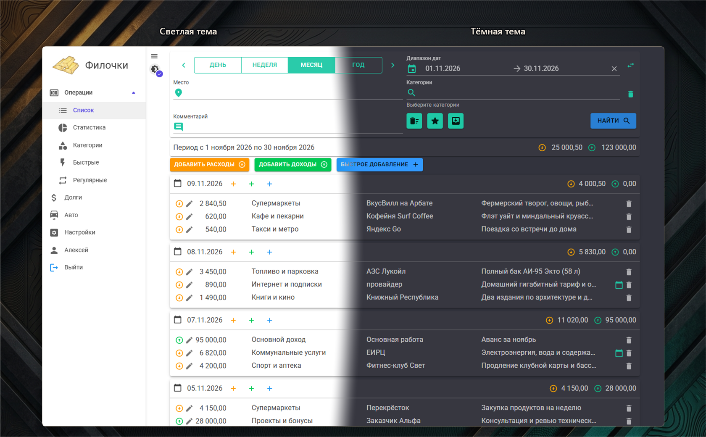
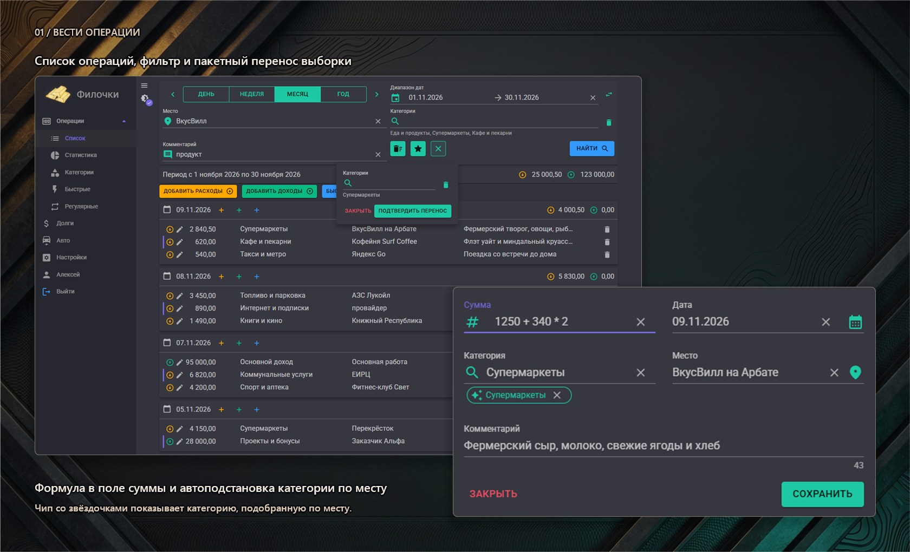
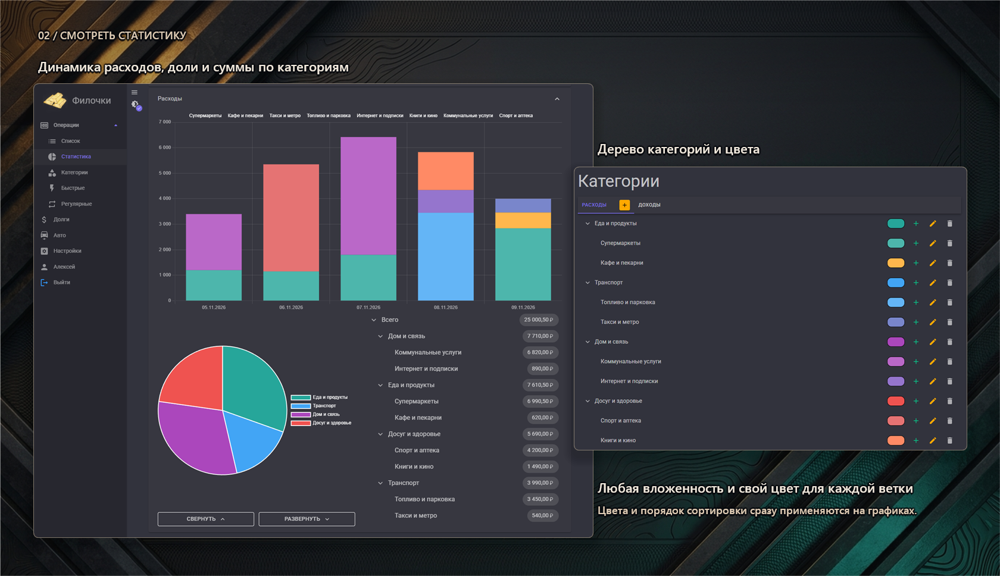
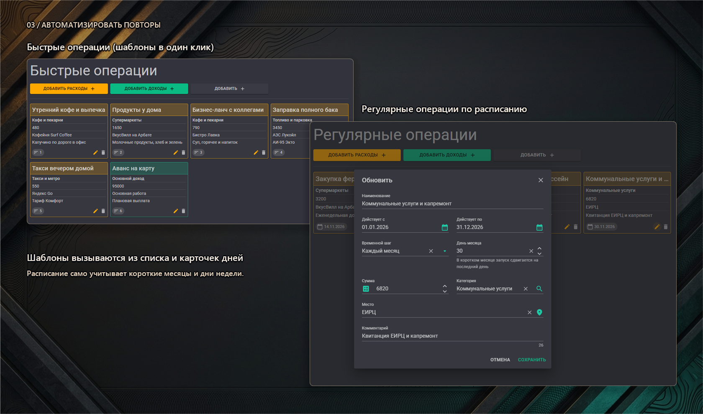
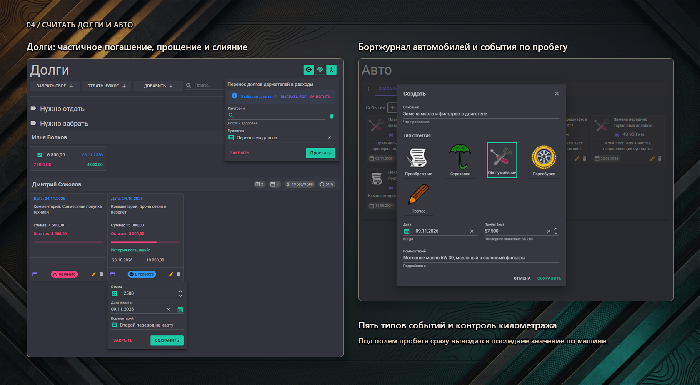
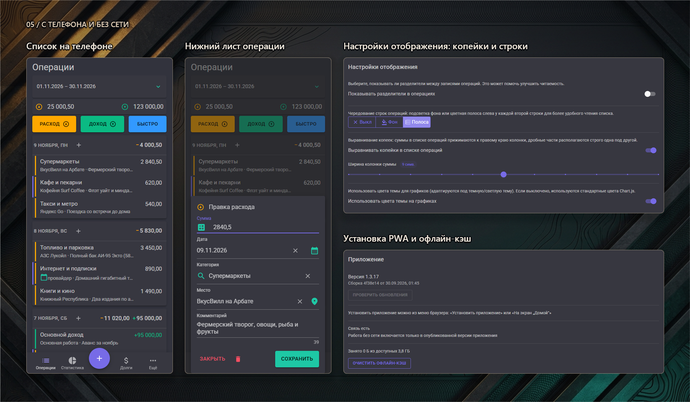

# Филочки (Money)


### Деньги снова разошлись, а куда, непонятно?

Зарплата вроде была недавно, а на карте опять пусто. Чеки из супермаркета складывать в уме лень,
подписки списываются тихо, знакомый уже третий месяц возвращает долг частями, а ТО машины снова
подкралось внезапно. Держать всё это в голове или в разрозненных табличках быстро надоедает.

**Филочки (Money)** помогают навести порядок в личных финансах без лишней бюрократии. Записывай
расходы и доходы на ходу: сумма сама посчитается по формуле из чека, дата поймёт короткое «в» или
«пв», а знакомое место подскажет нужную категорию. На графиках сразу видно, куда уходят деньги,
регулярные платежи и шаблоны экономят время, а разделы долгов и авто не дадут забыть ни про чужую
сотку, ни про замену масла.

[](https://github.com/MaxNagibator/Money/actions/workflows/main.yml)


**[Открыть приложение](https://money.bob217.ru)** · [Начать работу](#начать-работу) · [Руководство](GUIDE.md) · [Все скриншоты](assets/screenshots/README.md)



*Светлая и тёмная темы. Режим «Авто» следует за системой или включает тёмное оформление по твоему расписанию. Композиция собрана из настоящих снимков; [каждый экран отдельно](assets/screenshots/README.md).*

## Записывать траты и доходы на лету

Открываешь диалог операции, и курсор уже стоит в поле суммы. Набери `150+340*2`, нажми Enter:
приложение посчитает итог, но сохранит саму формулу, чтобы к ней можно было дописать ещё пару
позиций из длинного чека. В поле даты вместо календаря достаточно ввести `с` (сегодня), `в` (вчера),
`пв` (позавчера), `з` (завтра), `пз` (послезавтра) или цепочку вроде `ппв`.



Укажи место покупки: если последние 5 раз в этом месте выбиралась одна и та же категория, она
подставится автоматически и отметится чипом. Ошибся со строкой? Удалённая операция не пропадает
бесследно, а остаётся на месте зачёркнутой с кнопкой восстановления. Фильтр сверху отберёт записи по
периоду, месту, дереву категорий и комментарию, покажет дни без трат и позволит одним действием
перенести всю найденную выборку в другую категорию, а серверный экспорт выгрузит отфильтрованные
операции в книгу Excel.

[Умный ввод суммы, алиасы дат, автоподстановка категории и фильтры →](GUIDE.md#операции-и-умный-ввод)

## Видеть, куда уходят деньги

Страница «Статистика» делит общий фильтр со списком операций: выбрал период или ветку категорий в
одном месте, и графики уже готовы. Панели расходов и доходов строят столбчатую диаграмму динамики
по дням, неделям или месяцам с единым масштабом времени, а рядом показывают круговую диаграмму долей.



Справа от круговой диаграммы раскрывается дерево сумм по категориям и подкатегориям, отсортированное
по убыванию вклада. В разделе «Категории» настраивается любая глубина вложенности, порядок
сортировки и свой цвет для каждой ветки, который сразу применяется на графиках и в списках.

[Графики, дерево сумм и настройка категорий →](GUIDE.md#статистика-и-категории)

## Шаблоны и расписание вместо рутины

Частые покупки не нужно набивать заново. Создай шаблон в разделе «Быстрые операции», задай категорию,
место и приоритет сортировки: после этого шаблон вызывается в один клик из кнопки «Быстрое добавление»
над списком операций или кнопкой «+» в шапке карточки конкретного дня.



Для подписок, аренды и зарплаты есть «Регулярные операции». Задай период действия и шаг: каждый день,
каждую неделю в выбранный день (с подсказкой дня недели) или каждый месяц в нужное число (в коротких
месяцах запуск сам сдвинется на последний день). Созданные по расписанию записи отмечаются в списке
иконкой повтора.

[Быстрые шаблоны и регулярные операции →](GUIDE.md#шаблоны-и-регулярные-операции)

## Помнить про долги и обслуживание авто

Раздел «Долги» делит записи на «Нужно забрать» и «Нужно отдать», группируя их по держателям. Погашать
долг можно частями: форма оплаты сама подставит текущий остаток, сохранит историю каждого платежа с
датой и комментарием и обновит процент возврата. Безнадёжные долги можно отметить галочками и
**простить в расходы** с выбором категории, а если один человек записан под разными именами,
**слияние держателей** объединит его карточки без потери истории.



В разделе «Авто» у каждой машины своя вкладка с журналом событий: приобретение, страховка,
обслуживание, переобувка и прочее. При добавлении записи приложение сразу подсказывает под полем
пробега последнее известное значение по этой машине, чтобы не путаться в километраже.

[Частичное погашение, прощение долгов, слияние держателей и журнал авто →](GUIDE.md#долги-и-авто)

## На телефоне и без интернета

На узких экранах включается мобильная оболочка: нижняя панель навигации с центральной кнопкой «+»,
компактные карточки дней и выезжающие снизу шторки форм, которые подстраиваются под высоту экранной
клавиатуры. Случайный тап по затемнению не закроет форму и не сотрёт введённый чек.



В «Настройках» можно выровнять копейки в ровную колонку настраиваемой ширины, включить чередование
строк фоном или боковой полосой, задать ночное расписание тёмной темы и установить приложение как
PWA. Если пропала сеть или сервер недоступен, приложение откроется из офлайн-кэша и покажет
последние загруженные данные.

[Мобильная оболочка, настройка вида и работа офлайн →](GUIDE.md#мобильная-версия-и-работа-офлайн)

## Начать работу

1. Открой **[Филочки в браузере](https://money.bob217.ru)**. Чтобы сразу посмотреть все экраны на готовых данных за 12 месяцев, нажми **«Войти как демо»** на странице входа.
2. Для личного учёта зарегистрируйся по почте и паролю (или войди через `bob217.Auth` / `GitHub`), затем настрой дерево своих категорий в разделе «Категории».
3. Добавь первые траты и доходы, вынеси частые покупки в «Быстрые операции», а в «Настройках» установи приложение на устройство для быстрого запуска и чтения без сети.

## Как приложение обращается с данными

| Ситуация | Что происходит |
| --- | --- |
| Удаление операции, категории, шаблона, долга или события авто | Запись остаётся в списке зачёркнутой и восстанавливается в один клик до перезагрузки списка. |
| Пакетный перенос в фильтре операций | Все отфильтрованные на странице операции переходят в выбранную категорию одним действием. |
| Прощение долгов | Выбранные долги из «Нужно забрать» закрываются, а их непогашенный остаток записывается в расходы. |
| Слияние держателей долга | Все долги первого держателя переносятся ко второму, карточка-дубликат удаляется. |
| Потеря сети или недоступность сервера | Приложение открывается из кэша и отдаёт последние загруженные данные на чтение; запись блокируется до возврата связи. |
| Выход из учётной записи | Токены сессии и локальный офлайн-кэш данных пользователя полностью очищаются. |

[Ответы на частые вопросы и разбор нетривиальных сценариев →](GUIDE.md#faq)

## Собрать из исходников

Серверная часть написана на **ASP.NET Core (.NET 8)** и **PostgreSQL**, клиентское приложение в
`frontend-vue/` работает на **Vue 3**, TypeScript и Vite (каталог `frontend/Money.Web` хранит
прежнюю версию на Blazor WebAssembly). Для локального запуска нужны .NET 8 SDK, PostgreSQL,
Node.js 24 и `pnpm`:

```powershell
dotnet run --project backend/Money.Api/Money.Api.csproj --launch-profile https
pnpm --dir frontend-vue install --frozen-lockfile
pnpm --dir frontend-vue dev
```

Проверка фронтенда (линтер, типы, модульные тесты и сборка): `pnpm --dir frontend-vue verify`.

---

[Открыть приложение](https://money.bob217.ru) · [Подробное руководство](GUIDE.md) · [Галерея всех экранов](assets/screenshots/README.md) · [Сообщить о проблеме](https://github.com/MaxNagibator/Money/issues)

*Копейки сходятся, долги не теряются, а категории подставляются сами.*
